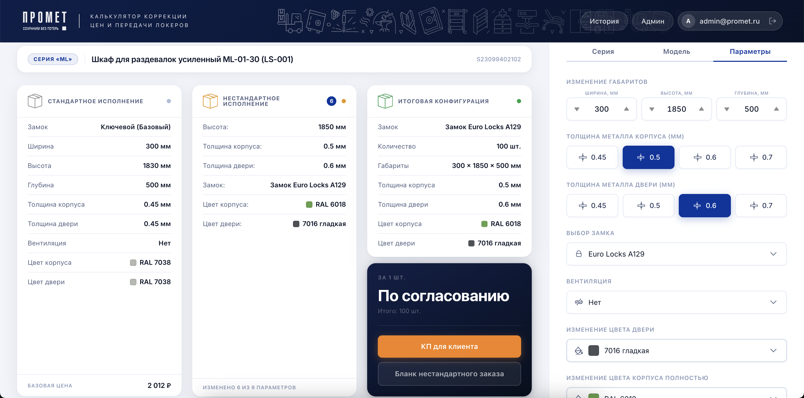
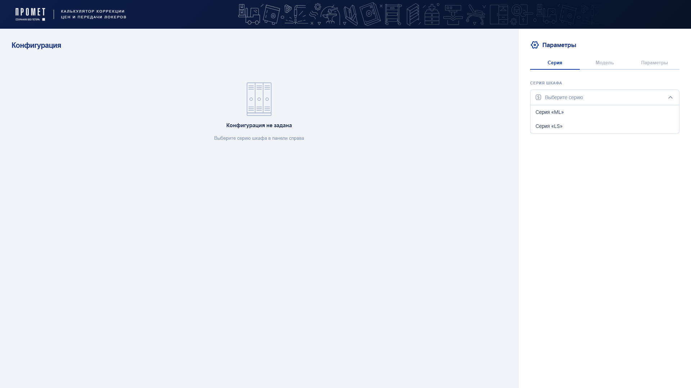
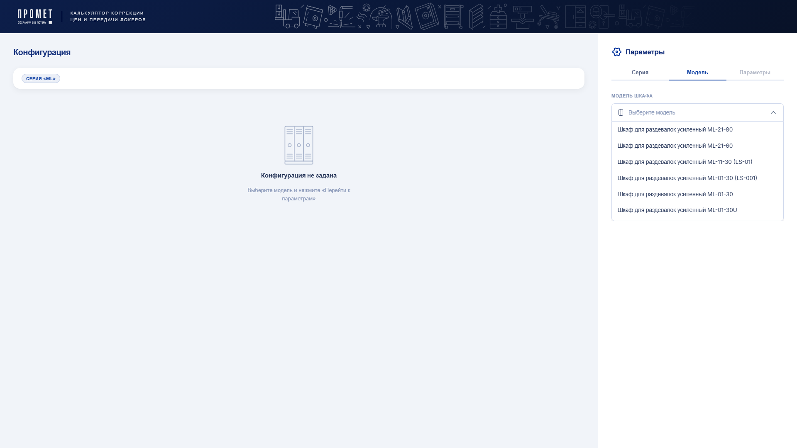
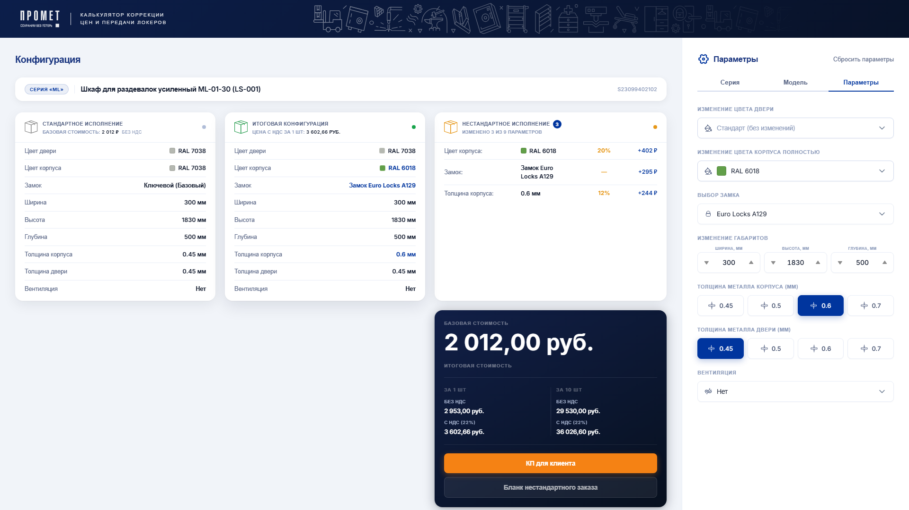
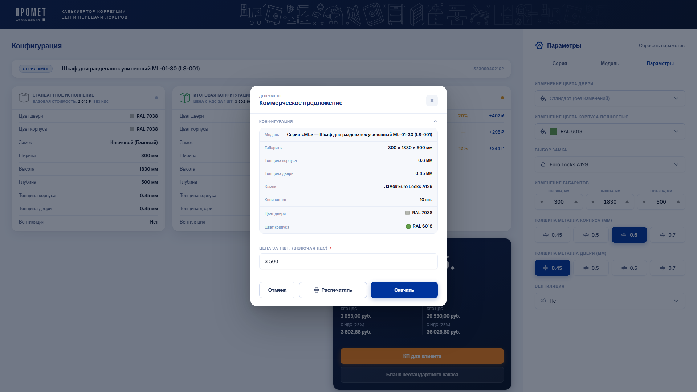
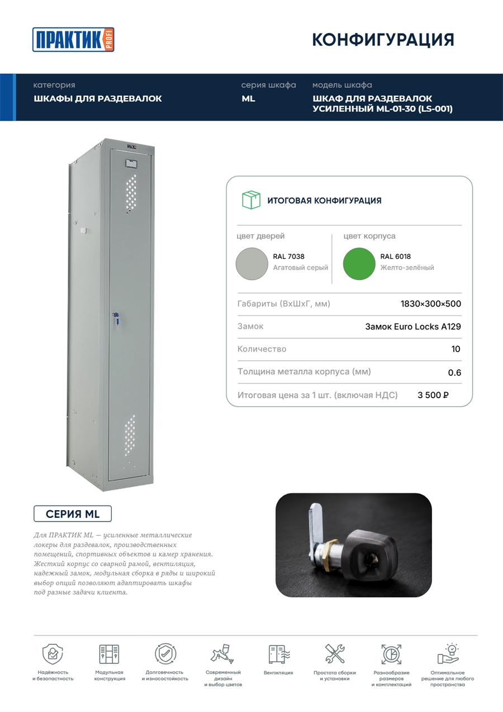

<p align="center">
  
</p>

<h1 align="center">Конфигуратор шкафов Промет</h1>

<p align="center">
  <b>Веб-приложение для подбора, расчёта цены и оформления заказов на металлические шкафы-локеры серий ML и LS.</b>
</p>

<p align="center">
  Внутренний инструмент отдела продаж ООО «НПО Промет»: менеджер собирает конфигурацию шкафа, сразу видит цену с НДС и без и в один клик получает коммерческое предложение и наряд-заказ в PDF.
</p>

<p align="center">
  
  
  
  <a href="https://github.com/dekciw/PrometConfigurator/releases/latest"></a>
  <a href="https://dekciw.github.io/PrometConfigurator/"></a>
</p>

<p align="center">
  <a href="https://dekciw.github.io/PrometConfigurator/">
    
  </a>
</p>

<br>

<p align="center">
  
</p>

<br>

<table align="center">
  <tr>
    <th>&#8199;&#8199;&#8199;&#8199;&#8199;&#8199;&#8199;&#8199;Конфигуратор&#8199;&#8199;&#8199;&#8199;&#8199;&#8199;&#8199;&#8199;</th>
    <th>&#8199;&#8199;&#8199;&#8199;&#8199;&#8199;&#8199;&#8199;Документы&#8199;&#8199;&#8199;&#8199;&#8199;&#8199;&#8199;&#8199;</th>
    <th>&#8199;&#8199;&#8199;&#8199;&#8199;&#8199;&#8199;&#8199;Админ-панель&#8199;&#8199;&#8199;&#8199;&#8199;&#8199;&#8199;&#8199;</th>
  </tr>
  <tr>
    <td valign="top">
      - Серия и модель<br>
      - Толщина металла<br>
      - Габариты шкафа<br>
      - Замок и вентиляция<br>
      - Цвет по RAL<br>
      - Цена с НДС и без
    </td>
    <td valign="top">
      - КП в PDF с фото модели<br>
      - Наряд-заказ в PDF<br>
      - Фирменный бланк<br>
      - Печать документов<br>
      - История конфигураций<br>
      - Повторное скачивание
    </td>
    <td valign="top">
      - Коэффициенты наценки<br>
      - Каталог и фото моделей<br>
      - Сортировка перетаскиванием<br>
      - Роли пользователей<br>
      - Блокировка доступа<br>
      - Вход по приглашению
    </td>
  </tr>
</table>

<h3 align="center">Как это работает</h3>

<table align="center">
  <tr>
    <td width="50%" align="center" valign="top">
      <br>
      <b>1. Серия</b><br>
      <sub>Выбираем серию шкафа: ML или LS</sub>
    </td>
    <td width="50%" align="center" valign="top">
      <br>
      <b>2. Модель</b><br>
      <sub>Выбираем модель из каталога серии</sub>
    </td>
  </tr>
  <tr>
    <td width="50%" align="center" valign="top">
      <br>
      <b>3. Параметры</b><br>
      <sub>Меняем замок, цвет, толщину и размеры. Каждое изменение и доплата видны сразу, цена пересчитывается</sub>
    </td>
    <td width="50%" align="center" valign="top">
      <br>
      <b>4. Коммерческое предложение</b><br>
      <sub>Проверяем конфигурацию, указываем цену для клиента и скачиваем PDF</sub>
    </td>
  </tr>
</table>

<h3 align="center">Что на выходе</h3>

<p align="center">
  
</p>

<p align="center">
  <sub>Готовое коммерческое предложение в PDF: фото модели, цвета корпуса и двери, габариты, замок, количество и цена за штуку</sub>
</p>

<br>

<details>
<summary><b>Подробнее о проекте: стек, устройство, расчёт цены, запуск</b> (нажми, чтобы развернуть)</summary>

<br>

### Стек

<p>
- <b>Интерфейс:</b> React 19, React Router 7, Motion 12, CSS Modules без сторонних UI-библиотек<br>
- <b>Сборка:</b> Vite 8<br>
- <b>Данные и вход:</b> Firebase 12 (Auth и Firestore)<br>
- <b>Документы:</b> pdf-lib и fontkit заполняют PDF-шаблоны КП и наряд-заказа<br>
- <b>Формы и интерфейс:</b> react-hook-form 7, <code>@dnd-kit</code> 6 для сортировки перетаскиванием, sonner 2 для уведомлений<br>
- <b>Проверка кода:</b> Vitest 2, Testing Library 16, ESLint 9, knip 6
</p>

### Устройство проекта

```
src/
├── pages/              # страницы: конфигуратор, админ-панель, история
├── modules/            # модули: Configurator, Parameters, Auth
├── shared/
│   ├── api/            # загрузка каталога из Firestore
│   ├── components/     # общие компоненты: шапка, модальные окна, уведомления
│   ├── context/        # общий контекст приложения
│   ├── hooks/          # хуки: каталог, история, конфигурация, админка
│   ├── lib/            # инициализация Firebase, загрузка фото
│   └── utils/          # расчёт цены, сравнение конфигураций, форматирование
└── pdf/
    ├── kp/             # коммерческое предложение
    └── nz/             # наряд-заказ
```

Каталог загружается из Firestore и кешируется в `localStorage` на 24 часа. Конфигурация живёт в состоянии приложения, а цена считается прямо в браузере в `calcPrice.js`, без запросов к серверу.

Макет интерфейса со всеми экранами и компонентами лежит в папке [`layout/`](./layout/) (файл Figma).

### Расчёт цены

```
цена = базовая цена × (1 + сумма коэффициентов доплат) + доплата за замок
```

Коэффициенты зависят от количества шкафов в заказе (от 1 до 100 и больше) и хранятся в Firestore, администратор меняет их в админ-панели. Если изменена ширина шкафа, цена считается вручную, и приложение подсказывает это менеджеру.

### Запуск

```bash
npm install
npm run dev        # dev-сервер
npm run build      # сборка
npm test           # тесты
npm run lint       # проверка кода
```

Для работы нужен файл `.env` с данными Firebase-проекта. Образец лежит в `.env.example`:

```
VITE_FIREBASE_API_KEY=...
VITE_FIREBASE_AUTH_DOMAIN=...
VITE_FIREBASE_PROJECT_ID=...
VITE_FIREBASE_STORAGE_BUCKET=...
VITE_FIREBASE_MESSAGING_SENDER_ID=...
VITE_FIREBASE_APP_ID=...
```


</details>

<!-- Pull Shark 1 -->

<!-- Pull Shark 2 -->
