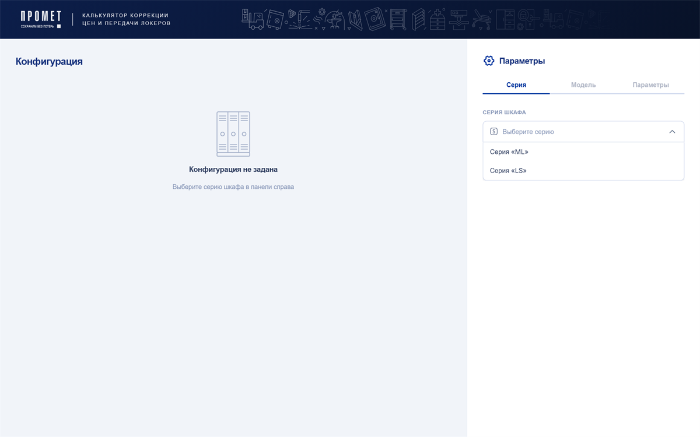
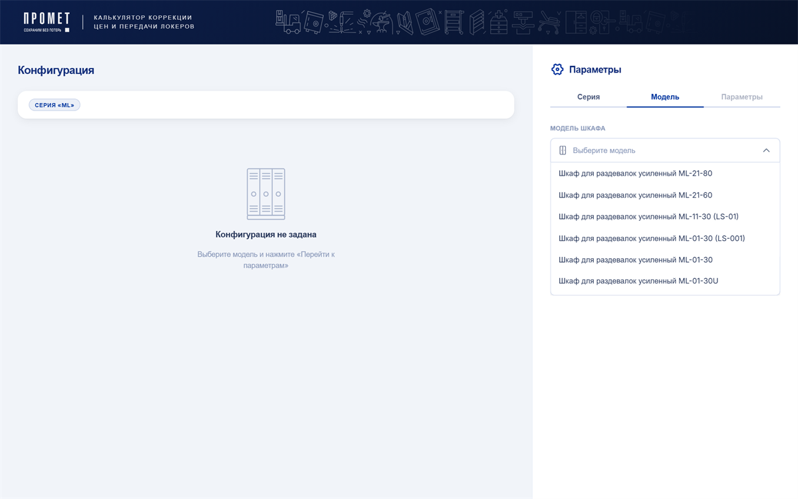
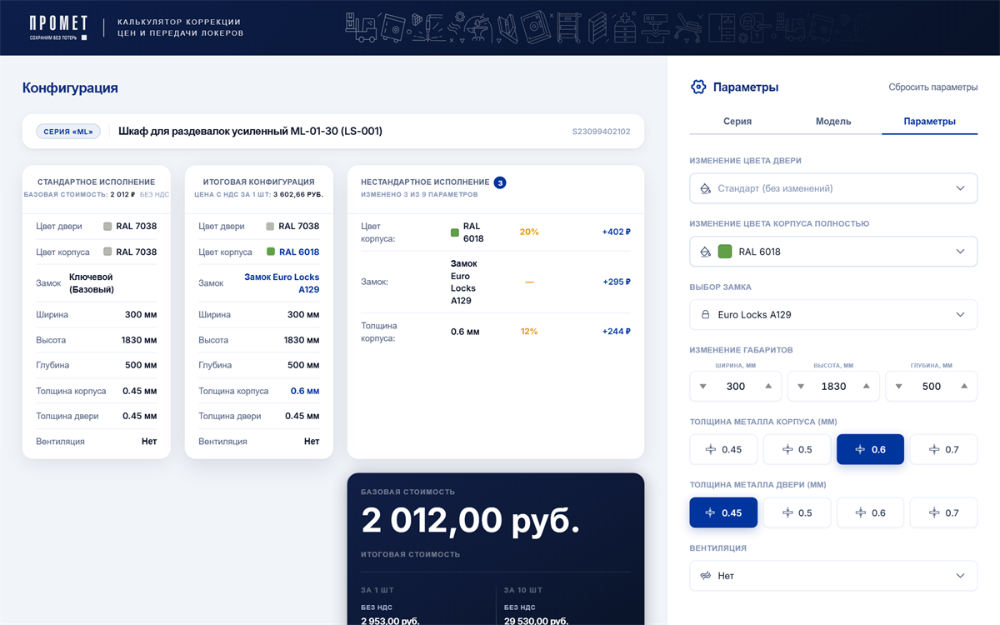
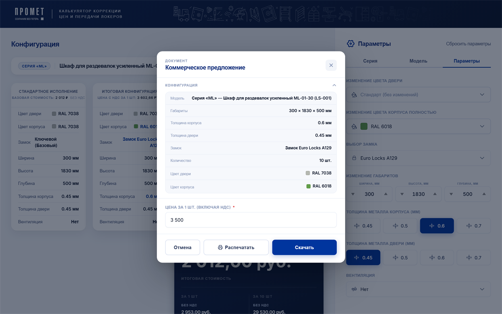

<p align="center">
  
</p>

<h1 align="center">Конфигуратор шкафов Промет</h1>

<p align="center">
  <b>Веб-приложение для подбора, расчёта цены и оформления заказов на металлические шкафы-локеры серий ML и LS.</b>
</p>

<p align="center">
  Внутренний инструмент отдела продаж ООО «НПО Промет»: менеджер собирает конфигурацию шкафа, сразу видит цену, вес и срок изготовления и в один клик получает коммерческое предложение и наряд-заказ в PDF.
</p>

<p align="center">
  
  
  
  <a href="https://github.com/dekciw/promet-lokers/releases/latest"></a>
  <a href="https://dekciw.github.io/promet-lokers/"></a>
</p>

<p align="center">
  <a href="https://dekciw.github.io/promet-lokers/">
    
  </a>
</p>

<br>

<p align="center">
  
</p>

<br>

<table align="center">
  <tr>
    <td width="33%" valign="top">
      <h3>Конфигуратор</h3>
      <p>
        - Серия и модель из каталога<br>
        - Толщина металла корпуса и двери<br>
        - Габариты: ширина, высота, глубина<br>
        - Замок, вентиляция, цвет по RAL<br>
        - Сравнение со стандартным исполнением<br>
        - Цена, вес и срок изготовления сразу
      </p>
    </td>
    <td width="33%" valign="top">
      <h3>Документы</h3>
      <p>
        - Коммерческое предложение в PDF на фирменном бланке с фото модели<br>
        - Наряд-заказ в PDF с параметрами для производства<br>
        - История: к любой конфигурации можно вернуться и скачать документы заново
      </p>
    </td>
    <td width="33%" valign="top">
      <h3>Админ-панель</h3>
      <p>
        - Коэффициенты наценки по размерам, толщине, вентиляции и цвету<br>
        - Каталог: модели, фото, сортировка перетаскиванием<br>
        - Пользователи: роли и блокировка<br>
        - Вход по коду приглашения
      </p>
    </td>
  </tr>
</table>

<h3 align="center">Как это работает</h3>

<table align="center">
  <tr>
    <td width="50%" align="center" valign="top">
      <br>
      <b>1. Серия</b><br>
      <sub>Выбираем серию шкафа: ML или LS</sub>
    </td>
    <td width="50%" align="center" valign="top">
      <br>
      <b>2. Модель</b><br>
      <sub>Выбираем модель из каталога серии</sub>
    </td>
  </tr>
  <tr>
    <td width="50%" align="center" valign="top">
      <br>
      <b>3. Параметры</b><br>
      <sub>Меняем замок, цвет, толщину и размеры. Каждое изменение и доплата видны сразу, цена пересчитывается</sub>
    </td>
    <td width="50%" align="center" valign="top">
      <br>
      <b>4. Коммерческое предложение</b><br>
      <sub>Проверяем конфигурацию, указываем цену для клиента и скачиваем PDF</sub>
    </td>
  </tr>
</table>

<h3 align="center">Что на выходе</h3>

<p align="center">
  
</p>

<p align="center">
  <sub>Готовое коммерческое предложение в PDF: фото модели, цвета корпуса и двери, габариты, замок, количество и цена за штуку</sub>
</p>

<br>

<details>
<summary><b>Подробнее о проекте: стек, устройство, расчёт цены, запуск</b> (нажми, чтобы развернуть)</summary>

<br>

## Содержание

- [Стек](#стек)
- [Устройство проекта](#устройство-проекта)
- [Расчёт цены](#расчёт-цены)
- [Запуск](#запуск)
- [Дизайн](#дизайн)

## Стек

| Инструмент | Версия | Назначение |
|---|---|---|
| React | 19 | Интерфейс |
| Vite | 8 | Сборка и dev-сервер |
| Firebase | 12 | Авторизация и база данных Firestore |
| React Router | 7 | Маршрутизация |
| Motion | 12 | Анимации |
| pdf-lib + fontkit | 1.17 | Заполнение PDF-шаблонов КП и наряд-заказа |
| react-hook-form | 7 | Формы |
| @dnd-kit | 6 | Сортировка каталога перетаскиванием |
| sonner | 2 | Уведомления |
| Vitest, Testing Library | 2, 16 | Тесты |
| ESLint, knip | 9, 6 | Проверка кода |

Компоненты написаны с нуля на CSS Modules и CSS-переменных, без сторонних UI-библиотек.

## Устройство проекта

```
src/
├── pages/              # страницы: конфигуратор, админ-панель, история
├── modules/            # модули: Configurator, Parameters, Auth
├── shared/
│   ├── api/            # загрузка каталога из Firestore
│   ├── components/     # общие компоненты: шапка, модальные окна, уведомления
│   ├── context/        # общий контекст приложения
│   ├── hooks/          # хуки: каталог, история, конфигурация, админка
│   ├── lib/            # инициализация Firebase, загрузка фото
│   └── utils/          # расчёт цены, сравнение конфигураций, форматирование
└── pdf/
    ├── kp/             # коммерческое предложение
    └── nz/             # наряд-заказ
```

Каталог загружается из Firestore и кешируется в `localStorage` на 24 часа. Конфигурация живёт в состоянии приложения, а цена считается прямо в браузере в `calcPrice.js`, без запросов к серверу.

## Расчёт цены

```
цена = базовая цена × (1 + сумма коэффициентов доплат) + доплата за замок
```

Коэффициенты зависят от количества шкафов в заказе (от 1 до 100 и больше) и хранятся в Firestore, администратор меняет их в админ-панели. Если изменена ширина шкафа, цена считается вручную, и приложение подсказывает это менеджеру.

## Запуск

```bash
npm install
npm run dev        # dev-сервер
npm run build      # сборка
npm test           # тесты
npm run lint       # проверка кода
```

Для работы нужен файл `.env` с данными Firebase-проекта. Образец лежит в `.env.example`:

```
VITE_FIREBASE_API_KEY=...
VITE_FIREBASE_AUTH_DOMAIN=...
VITE_FIREBASE_PROJECT_ID=...
VITE_FIREBASE_STORAGE_BUCKET=...
VITE_FIREBASE_MESSAGING_SENDER_ID=...
VITE_FIREBASE_APP_ID=...
```

## Дизайн

Макет интерфейса со всеми экранами и компонентами лежит в папке [`layout/`](./layout/) (файл Figma).

</details>

<!-- Pull Shark 1 -->

<!-- Pull Shark 2 -->
